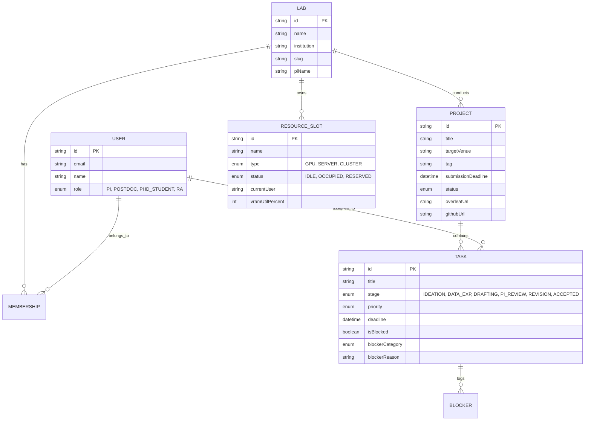

# LabFlow 🧪

> **Paper-Driven & Blocker-Aware Workflow OS for Academic Research Labs**  
> **面向学术课题组与实验室的“论文导向与科研卡点驱动”工作流操作系统**

[](https://nextjs.org/)
[](https://www.typescriptlang.org/)
[](https://tailwindcss.com/)
[](https://www.prisma.io/)
[](https://www.docker.com/)
[](LICENSE)

---

## 🌟 English Overview / 英文概览

Academic research is governed by publication deadlines (DDLs), Overleaf drafts, complex empirical pipelines, GPU cluster contention, and sudden mathematical proof bottlenecks. Generic project management tools like **Jira** (built for enterprise sprint tickets) or **Notion** (unstructured blank canvases) fail to capture the reality of academic research.

**LabFlow** is purpose-built from the ground up for Principal Investigators (PIs), Postdocs, PhD students, and Research Assistants (RAs). It replaces ad-hoc PPT group meetings with a paper-centric 6-stage publication board, reverse submission deadline scheduling, explicit technical bottleneck escalation, and shared GPU compute telemetry.

---

## 🇨🇳 中文简介 / Chinese Overview

学术科研管理的核心是**论文发表周期、投稿 Deadline、LaTeX/Overleaf 协作、复杂实验跑批、GPU 算力挤兑以及突发的数学推导与收敛性卡点**。通用的项目管理工具（如 Jira、Trello、Notion）无法适配学术课题组的真实工作流：
- **Jira / Linear**：专为软件工程敏捷冲刺（Sprint）设计，充斥着对于学术无用的故事点（Story Points）与敏捷燃尽图；
- **Notion**：自由度过高缺乏约束，通常沦为信息垃圾堆，无法自动推导论文截稿期或在组会中高效投屏。

**LabFlow** 是专为高校、科研院所课题组打造的开源学术科研操作系统（Academic Research Lab OS）。通过 6 阶段学术看板、投稿倒推排期生成器（Reverse DDL Planner）、数学与算力卡点闭环求助机制、无 PPT 组会投屏模式及算力资源仪表盘，全面赋能顶尖实验室的高效产出。

---

## ⚖️ Why LabFlow vs. Jira & Notion? (对比分析)

| 核心维度 / Feature Dimension | Jira / Linear | Notion / Trello | **LabFlow (Academic OS)** |
| :--- | :--- | :--- | :--- |
| **工作流哲学 (Core Paradigm)** | 软件工程敏捷冲刺 (Sprint / Backlog) | 自由文档笔记 / 通用轻量看板 | **论文与课题导向 (Paper-Driven Pipeline)** |
| **流转阶段 (Board Stages)** | Todo / In Progress / Done | 自定义列 (无学术语义) | **IDEATION → DATA_EXP → DRAFTING → PI_REVIEW → REVISION → ACCEPTED** |
| **投稿倒排机制 (Reverse DDL)** | ❌ 无 (需手动计算工期) | ❌ 静态日历 (无法自动生成里程碑) | **⚡ 自动倒推生成 T-45/T-30/T-14/T-3 关键学术节点** |
| **卡点求助 (Blocker Handling)** | 仅有简单 Flag 标记 | 评论区艾特 (极易淹没) | **🔥 细分卡点类型 (数学推导/算法收敛/算力瓶颈)，直接向 PI 求助** |
| **资产快速直达 (Asset Links)** | 自定义字段 (折叠层级深) | 链接嵌入 | **Overleaf、GitHub、Zenodo/Dataset、Zotero 卡片一键直达** |
| **组会汇报 (Group Standup)** | ❌ 无法直观投屏 | 需学生花费半天准备 PPT | **🖥️ 无 PPT 投屏模式：3 栏汇报视图 + 1 秒导出 Markdown 纪要** |
| **算力资源协同 (Compute Slots)** | ❌ 无关联 | 需单独维护表格 | **内置 GPU/HPC 节点占用、剩余机时与一键认领 (Claim)** |

---

## 🚀 Key Features Breakdown / 核心功能详解

### 1. 📌 Paper-First Academic Pipeline Board (论文全生命周期学术看板)
Generic boards use `Todo / Doing / Done`. LabFlow provides a **6-stage horizontal research pipeline**:
1. `IDEATION` (Ideation & Lit Review / 灵感与文献): Hypotheses formulation, survey matrix, IRB clearance.
2. `DATA_EXP` (Data & Modeling / 数据与实验): Empirical estimation, algorithm prototyping, benchmark runs.
3. `DRAFTING` (Manuscript Drafting / 初稿撰写): Overleaf LaTeX drafting, high-DPI vector figure generation.
4. `PI_REVIEW` (PI Review / 导师审阅): Structural critique, Theorem tightness check, advisor sign-off.
5. `REVISION` (Submitted & R&R / 投稿与返修): Peer review rebuttal, placebo tests, track-changes revision diffs.
6. `ACCEPTED` (Accepted & Archived / 录用归档): Camera-ready formatting, Zenodo code DOI minting, celebratory confetti!

**Card Visual Elements**:
- **Project/Paper Tag** (`AAAI 2027`, `AEPP (R&R)`, `World Bank WP`) with **DDL Countdown Badges** (auto-color-coded: urgent pulsing red for $\le 3\text{d}$, amber for $\le 14\text{d}$, cyan for normal).
- **Direct Asset Quick-Links**: Instant clickable pills for `Overleaf`, `GitHub`, `Dataset`, and `Zotero`.
- **Author Badges**: Instant recognition of Lead Author (`[Lead: Kayn]`) and Principal Investigator (`[PI: Prof. Malone]`).
- **Pulsing Blocker Highlight**: Highlighted in pulsing red border when blocked, with category tag and one-click unblock action.

---

### 2. 🔥 The "Blocker Escalation" Modal & Filter (科研卡点上报与闭环求助)
Academic projects frequently stall on domain-specific roadblocks. LabFlow turns hidden friction into explicit lab decisions:
- **Top Toggle: "🔥 Only Show Blockers (仅看卡点)"**: Instantly isolate only blocked cards across the lab.
- **Dedicated Blocker Categories**:
  - `MATH_DERIVATION` (数学推导与证明): Contraction bounds, Lyapunov stability divergence, Lemma proofs.
  - `ALGO_CONVERGENCE` (算法与模型收敛异常): Loss explosion, oscillating dual variables, NaN gradients.
  - `COMPUTE_SHORTAGE` (算力与GPU瓶颈): OOM on 80GB VRAM, Slurm queue timeouts.
  - `DATA_DEFICIT` (数据缺失与协议延迟): Missing survey response waves, API rate limits.
  - `WAITING_REVIEW` (等待导师/共作审阅): Stalled Overleaf feedback.
  - `REPLICATION_GAP` (经验复现差异): Baseline reproduction discrepancies.
- **Structured Fields**: *Where is it stuck?* + *What has been tried?* + *Escalate to (PI, Postdoc, Senior PhD)*.
- **One-Click Resolution**: Direct unblocking with instant visual feedback and celebratory confetti.

---

### 3. ⚡ Reverse DDL Scheduler (投稿倒推排期生成器)
Top-tier conferences and journals (NeurIPS, AAAI, ICML, Management Science, AER) demand disciplined backwards planning.
- Input: **Paper Title**, **Target Venue**, and **Submission Deadline (T-Day)**.
- Automatically calculates and injects 4 coordinated milestone tasks onto the board:
  - `T - 45 Days` (`DATA_EXP`): **Baseline & Core Empirical Results Freeze**
  - `T - 30 Days` (`DRAFTING`): **Full Manuscript First Draft Ready (Overleaf)**
  - `T - 14 Days` (`PI_REVIEW`): **Submit Polished PDF to PI for Internal Review**
  - `T - 3 Days` (`PI_REVIEW`): **Camera Formatting, Double-Blind Anonymity & Code Check**

---

### 4. 🖥️ Group Meeting Standup Mode (无PPT组会投屏模式)
Tired of students spending 6 hours making slides every week for a 10-minute update?
- **High-contrast presenter dashboard** designed for conference room 4K projectors and Zoom screen sharing.
- **Presenter Filter**: Easily cycle between All Members, PI, Postdoc, PhDs, and RAs.
- **3-Column Executive Summary**:
  1. *Completed Recently (近期进展)*: Archived publications & verified milestones.
  2. *Active & In Progress (当前推进)*: Ongoing empirical and manuscript progress.
  3. *Critical Blockers Requiring PI Decision (核心卡点与导师决断)*: High-priority roadblocks with what was tried and who must intervene.
- **📋 Export Markdown Minutes (导出组会纪要)**: Automatically compiles clean, structured meeting minutes into clipboard, ready to paste into Slack, WeChat, Notion, or Email!

---

### 5. 💻 Shared Compute & Lab Resource Widget (算力与公共设施状态栏)
- Real-time status strip showing shared cluster utilization:
  - `GPU Node-01 (4x NVIDIA A100-80G)`: Occupied by `@Alex Rivera` (ADMM 10k Graph Training - 12h left, 94% VRAM)
  - `GPU Node-02 (8x RTX 4090 24GB)`: Idle / Available for ablation sweeps
  - `Survey/Econometric Server (64-core AMD EPYC)`: Active (`@Elena Vance` - Stata Placebo runs)
  - `DGX H100 SuperPOD (Node-Alpha)`: Reserved for Causal Pretraining
- Interactive modal: **Claim an idle node** (specify job name, member, duration) or **Release an occupied node**.

---

## 🛠️ Quick Start & Standalone App / 快速开始与免部署桌面端

### Option 0: 🖥️ 1-Click Windows / Desktop Launcher (无需命令行，开箱即用)
如果你不想敲命令行，从 GitHub 下载本项目后：
1. **双击 `Start-LabFlow.bat`**（Windows 用户）或运行 `./Start-LabFlow.ps1`：
   - 脚本将自动检测 Node.js，并在首次运行时自动安装依赖，随后自动唤起默认浏览器访问 `http://localhost:3000`。
2. **免部署安装为独立桌面应用 (PWA Standalone App)**：
   - 打开页面后，点击 Chrome 或 Edge 浏览器地址栏右侧的 **“安装 LabFlow” (或“应用” → “将此站点作为应用安装”)** 图标。
   - 即可将 LabFlow 转化为完全独立的桌面应用窗口（无浏览器地址栏，具备独立任务栏图标与原生应用体验）。
   - 全部数据保存在本地客户端，离线亦可流畅使用。

---

### Option A: Local Development (常规本地开发)
LabFlow includes a pre-populated reactive mock store in `localStorage`, allowing immediate execution without configuring a database:

```bash
# 1. Clone repository
git clone https://github.com/your-username/labflow.git
cd labflow

# 2. Install dependencies
npm install

# 3. Start local development server
npm run dev
```

Open [http://localhost:3000](http://localhost:3000) in your browser. All features (drag-and-drop, blocker escalation, reverse DDL, group meeting projection, resource claim) work interactively out of the box!

---

### Option B: Docker Compose (Production Deployment)
Deploy LabFlow alongside PostgreSQL with a single command:

```bash
docker compose up -d --build
```

Access the application at `http://localhost:3000`. PostgreSQL will automatically be provisioned on port `5432` with volume persistence.

---

## 🗄️ Prisma Data Model Overview (`prisma/schema.prisma`)

LabFlow includes an enterprise-ready PostgreSQL schema designed for multi-lab academic institutions:



---

## 📁 Project Structure / 代码目录结构

```
labflow/
├── prisma/
│   └── schema.prisma            # Production PostgreSQL relational schema
├── src/
│   ├── app/
│   │   ├── globals.css          # Tailwind CSS & custom scrollbar definitions
│   │   ├── layout.tsx           # Root metadata & font declarations
│   │   └── page.tsx             # Main application entry point
│   ├── components/
│   │   ├── icons/
│   │   │   └── BrandIcons.tsx   # Pixel-perfect Overleaf & GitHub brand SVGs
│   │   ├── BlockerModal.tsx     # Feature B: Blocker escalation & resolution modal
│   │   ├── GanttView.tsx        # Project-grouped timeline Gantt with collapsible accordions
│   │   ├── GroupMeetingView.tsx # Feature D: Group meeting standup presenter mode & personal weekly digest
│   │   ├── Header.tsx           # Navigation bar, blocker filter, backup/restore & mode switcher
│   │   ├── KanbanBoard.tsx      # Feature A: 6-stage academic board with stage filter & DDL sorting
│   │   ├── KanbanCard.tsx       # Research card with DDL badges & asset quick-links
│   │   ├── MainApp.tsx          # Dynamic view renderer
│   │   ├── MemberManagerModal.tsx # Customizable lab roster & user identity center
│   │   ├── NewTaskModal.tsx     # Ad-hoc task and milestone creator
│   │   ├── ResourceModal.tsx    # Compute node claim & release manager
│   │   ├── ResourceStrip.tsx    # Feature E: Live GPU & HPC resource status strip
│   │   ├── ReverseDDLModal.tsx  # Feature C: Reverse DDL scheduler with custom venues & milestone offsets
│   │   ├── StageSettingsModal.tsx # Customizable academic pipeline stages editor
│   │   ├── TaskDetailDrawer.tsx # Task inspector, subtasks & top-tier rubric injection
│   │   └── Toast.tsx            # Floating toast notification system
│   ├── context/
│   │   └── LabFlowContext.tsx   # Reactive state store with localStorage persistence
│   ├── data/
│   │   └── mockData.ts          # Realistic initial academic lab datasets
│   ├── types/
│   │   └── index.ts             # TypeScript definitions for academic workflows
│   └── utils/
│       ├── confetti.ts          # Celebratory milestone canvas confetti
│       └── date.ts              # Reverse DDL math & meeting minutes compiler
├── Dockerfile                   # Multi-stage optimized production Dockerfile
├── docker-compose.yml           # App + PostgreSQL container orchestration
├── tailwind.config.ts           # Tailwind typography & dark mode palette
└── README.md                    # Bilingual documentation & architecture guide
```

---

## 🧪 Built-in Realistic Mock Data

LabFlow loads with publication-grade academic projects pre-configured:
1. **Digital Servitization & Producer Subscription Dynamics** (`Target: AEPP / IFAMR (Revise & Resubmit)`, Lead: Kayn Zhang, PI: Prof. Malone, Stata replication do-files, Zenodo dataset).
2. **Inexact ADMM with MCR2 Constraints for Multi-Agent Consensus** (`Target: AAAI 2027 Oral`, Lead: Alex Rivera, marked as **BLOCKED** on `Math Derivation` Lemma 4.2 contraction proof, GPU Node-01 occupied).
3. **Systematic PRISMA Meta-Regression on Regenerative Ag Adoption** (`Target: World Bank Working Paper`, Lead: Elena Vance, Zotero library with 2,400 screened citations).
4. **Dynamic Factor Models for High-Frequency Carbon Pricing** (`Target: Energy Economics`, Status: `PI_REVIEW`).
5. **Federated Causal Trees in Public Health** (`Target: Nature Communications`, Status: `ACCEPTED`, DOI minted).

---

## 📜 License & Citation

LabFlow is open-sourced under the **MIT License**.

If you use LabFlow to coordinate your research group or paper submissions, please feel free to star the repository and cite:

```bibtex
@software{labflow2026,
  author = {LabFlow Open Source Contributors},
  title = {LabFlow: Paper-Driven & Blocker-Aware Workflow OS for Academic Research Labs},
  year = {2026},
  url = {https://github.com/your-username/labflow}
}
```
